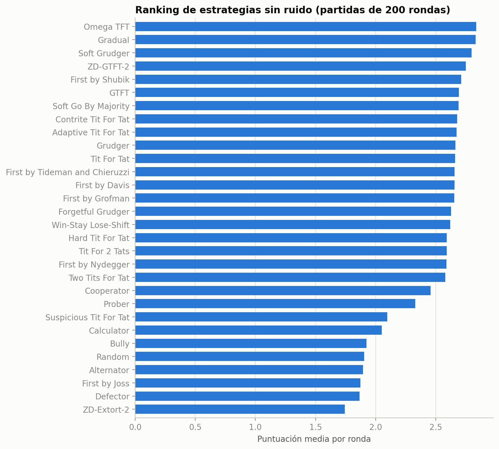
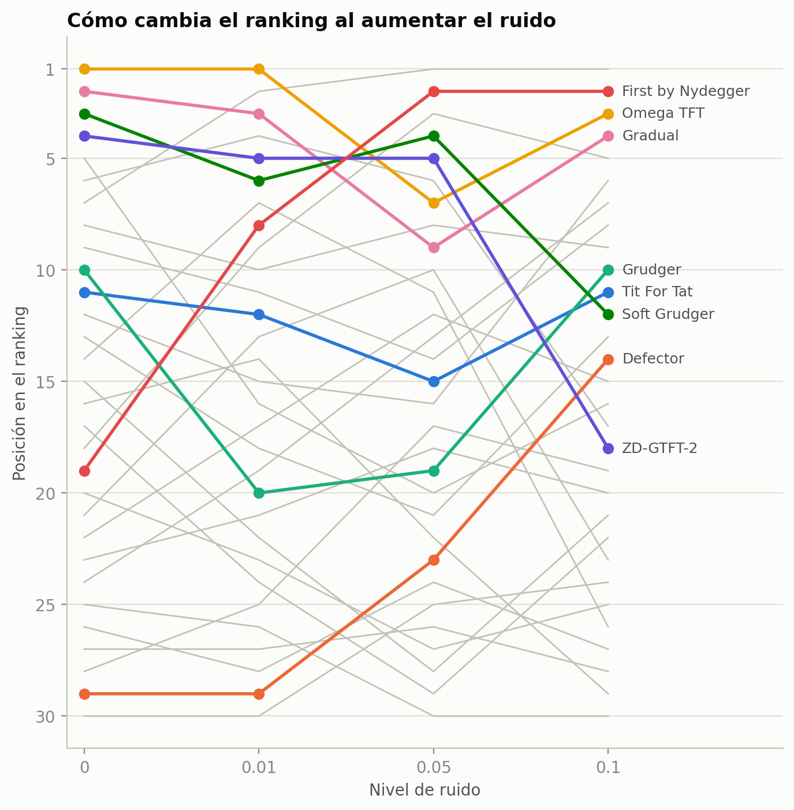
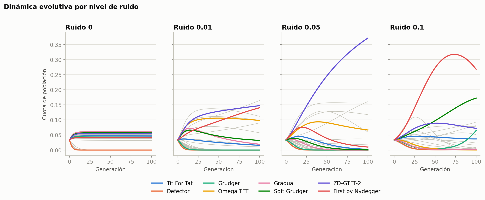
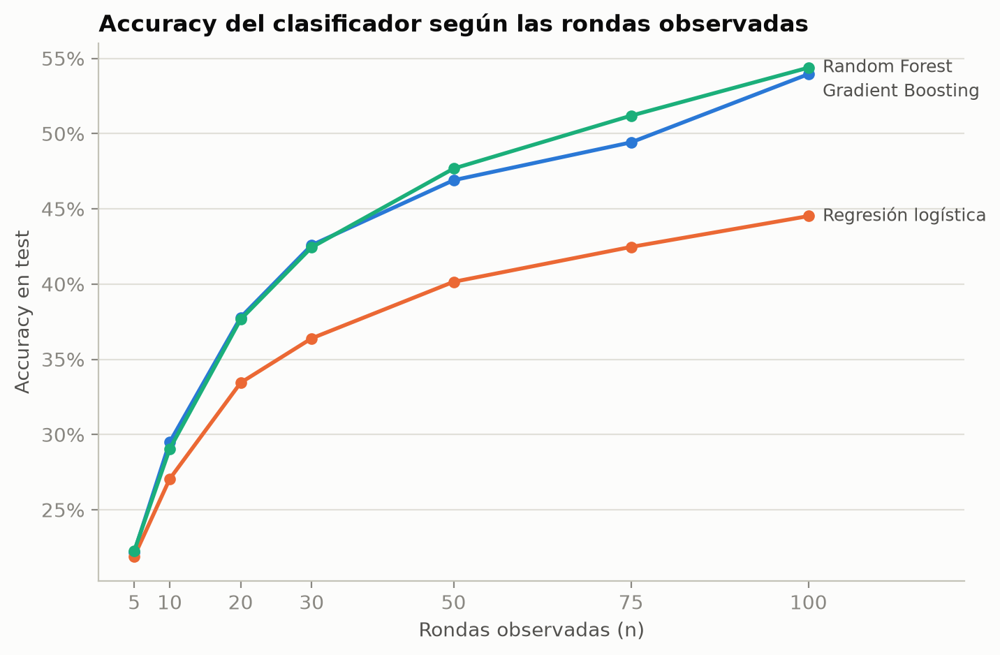
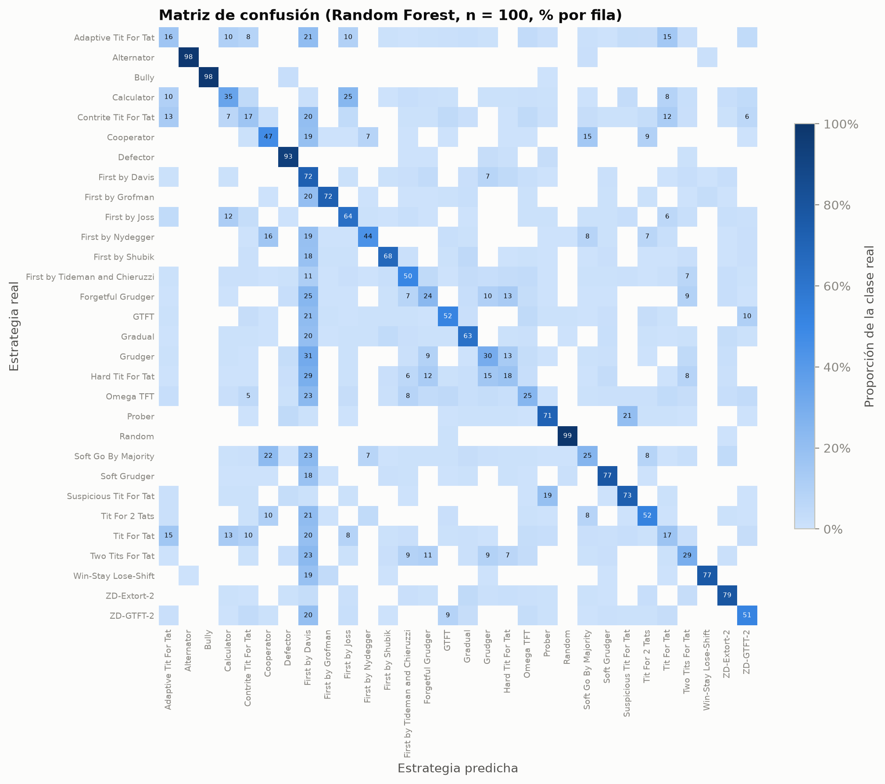
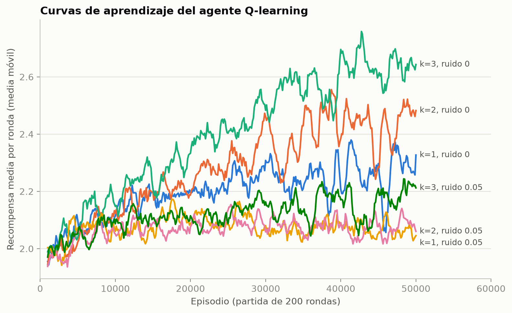
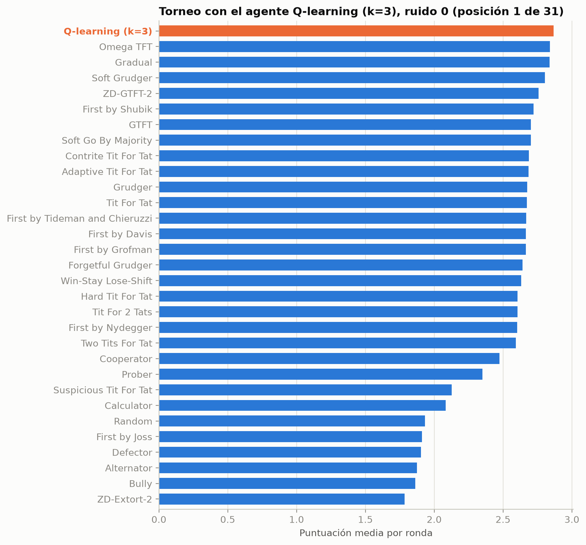

# Torneos de Axelrod a escala: simulación, pipelines de datos y aprendizaje automático

Plataforma para simular de forma masiva torneos del **dilema del prisionero iterado** (al estilo de
los torneos de Axelrod) con 30 estrategias clásicas, 4 niveles de ruido y partidas de 100 y 200
rondas. Las jugadas se procesan en un *data lake* por capas con Spark y se usan para entrenar un
**clasificador que reconoce la estrategia de un jugador por su forma de jugar** y un **agente de
Q-learning** que aprende a jugar. Todo se sirve en una API con una demo web en la que un humano
juega contra la IA.

**Demo desplegada:** <https://axelrod-demo.bravewave-4aca7c61.swedencentral.azurecontainerapps.io/>

---

## Arquitectura por capas

```
┌──────────────────────────────────────────────────────────────────────────────┐
│ 1. SIMULACIÓN          tfm_axelrod/simulate.py  (librería axelrod)           │
│    local o 4 contenedores en Azure Container Instances (uno por ruido)       │
└──────────────────────────────┬───────────────────────────────────────────────┘
                               │ Parquet (una fila por jugada y jugador)
┌──────────────────────────────▼───────────────────────────────────────────────┐
│ 2. DATA LAKE  (ADLS Gen2, sistema de ficheros "lake")                        │
│    raw/        roundrobin/ · evolutionary/                                   │
│    curated/    curated_moves · curated_evolution            ← validación     │
│    analytics/  analytics_match_summary · analytics_strategy_ranking          │
│                analytics_classifier_features · figures/                      │
│    Pipelines Spark: notebooks de Databricks (pipelines/) y su port a un      │
│    contenedor de ACI (tfm_axelrod/spark_pipelines.py)                        │
└──────────────────────────────┬───────────────────────────────────────────────┘
                               │ 17 características por (partida, jugador, n rondas)
┌──────────────────────────────▼───────────────────────────────────────────────┐
│ 3. MODELOS          MLflow (backend sqlite + Model Registry)                 │
│    Clasificador de estrategias  tfm_axelrod/train_classifier.py              │
│    Agente Q-learning tabular    tfm_axelrod/qlearning.py                     │
└──────────────────────────────┬───────────────────────────────────────────────┘
                               │ models/classifier_serving · models/qlearning
┌──────────────────────────────▼───────────────────────────────────────────────┐
│ 4. SERVICIO         FastAPI  tfm_axelrod/api.py  (/health, /predict, /play)  │
│    demo web estática en /   ·   imagen Docker   ·   Azure Container Apps     │
└──────────────────────────────────────────────────────────────────────────────┘
```

En la demo, la IA decide su jugada **solo con el historial previo**: nunca ve la jugada actual del
humano.

## Estructura del repositorio

```
tfm-axelrod/
├── tfm_axelrod/                 Paquete principal
│   ├── strategies.py            Presets de estrategias (small: 5, full: 30)
│   ├── simulate.py              Motor de simulación (round-robin y evolutivo) → Parquet
│   ├── cloud.py                 Subida y descarga del data lake (SDK de Azure, opcional)
│   ├── spark_pipelines.py       Pipelines raw → curated → analytics en Spark local
│   ├── compare_tables.py        Compara dos versiones de la tabla de características
│   ├── features.py              Las 17 características en Python (igual que en Spark)
│   ├── train_classifier.py      Clasificador: 3 algoritmos × 7 valores de n, MLflow
│   ├── export_serving.py        Exporta los modelos ligeros que usa la API
│   ├── qlearning.py             Agente Q-learning (axl.Player), entrenamiento y evaluación
│   ├── plot_style.py            Estilo común de las figuras
│   ├── api.py                   API FastAPI
│   └── web/index.html           Demo interactiva
├── pipelines/                   Notebooks de Databricks (01 raw→curated, 02 →analytics, 03 EDA)
├── scripts/
│   ├── compact_raw.py           Compacta raw en un Parquet por partición para subirlo al lake
│   ├── build_head_to_head.py    Tabla de enfrentamientos que usa la API
│   ├── run_cloud_simulation.ps1 Simulación distribuida en Azure Container Instances
│   └── run_cloud_pipelines.ps1  Pipelines Spark en Azure Container Instances
├── tests/                       Tests (pytest)
├── models/
│   ├── classifier_serving/      Gradient Boosting por n (lo usa la API, ~17 MB)
│   ├── qlearning/               Tablas Q de las 6 configuraciones
│   └── head_to_head.json        Puntuación media de cada estrategia contra cada rival
├── docs/
│   ├── figures/                 Figuras 01–12
│   └── results/                 Métricas en CSV
├── Dockerfile                   Imagen de la API
├── Dockerfile.simulate          Imagen del simulador (ACI)
├── Dockerfile.spark             Imagen de los pipelines Spark (ACI)
├── requirements-*.txt           Dependencias fijadas de cada imagen
└── pyproject.toml · uv.lock     Entorno del proyecto (uv)
```

No se versionan (`.gitignore`): `data/` (capas del lake en local), `mlruns/`, `mlflow.db` y
`models/classifier/` (los Random Forest, ~490 MB, se regeneran con el entrenamiento).

---

## Cómo reproducirlo

Requisitos: Python 3.12 y [uv](https://docs.astral.sh/uv/). Para Spark hace falta además Java 17
o 21. Todos los comandos se ejecutan desde la raíz del repositorio.

```bash
uv sync --all-extras    # entorno completo (incluye los extras "azure" y "spark")
```

Los extras son opcionales: `uv sync` instala solo lo necesario para la simulación local, el
clasificador, el agente y la API.

### 1. Simulación

Torneo round-robin completo (30 estrategias, todos contra todos incluida la autopartida,
4 ruidos, 100 y 200 rondas, 10 repeticiones) y dinámica evolutiva del replicador:

```bash
uv run python -m tfm_axelrod.simulate --preset full --noise 0 0.01 0.05 0.1 --turns 100 200 --repetitions 10 --seed 42
uv run python -m tfm_axelrod.simulate --mode evolutionary --preset full --noise 0 0.01 0.05 0.1 --seed 42
```

Escriben en `data/raw/roundrobin/noise=*/turns=*/ro_31bf8b854b39.parquet` y
`data/raw/evolutionary/ev_f1d3a4211a6d.parquet`. Los identificadores y las semillas de cada
partida son deterministas: la misma configuración produce las mismas jugadas.

Para una prueba rápida (5 estrategias, en una carpeta aparte para no mezclarla con `data/raw`):
`uv run python -m tfm_axelrod.simulate --preset small --turns 50 --out data/prueba`.

### 2. Pipelines de Spark (raw → curated → analytics)

Los pipelines se escribieron y ejecutaron como notebooks de Databricks (`pipelines/01_raw_to_curated.py`,
`pipelines/02_curated_to_analytics.py`; `pipelines/03_eda.py` genera las figuras 01–06).
`tfm_axelrod/spark_pipelines.py` porta la misma lógica, sin cambiar reglas ni definiciones, para
ejecutarla con Spark en local o en un contenedor:

```bash
uv run --extra spark python -m tfm_axelrod.spark_pipelines --raw data/raw --out data/spark --driver-memory 12g
```

Imprime el informe de calidad y el número de filas de cada tabla, y termina con error si hay filas
inválidas o los recuentos no son los esperados. Para comprobar que la tabla de características
coincide con la que generó Databricks:

```bash
uv run python -m tfm_axelrod.compare_tables data/spark/analytics/analytics_classifier_features data/analytics/classifier_features.parquet
```

> En Windows sin `winutils.exe`, Spark no puede leer ni escribir ficheros locales; el módulo lo
> detecta y hace la lectura y escritura con pyarrow (las transformaciones siguen en Spark). En
> ese modo cada tabla se recoge entera en el driver, por eso el comando pide 12 GB: con los 5 GB
> por defecto (pensados para el contenedor de 8 GB, donde la E/S es la nativa de Spark) se queda
> sin memoria.

### 3. Clasificador de estrategias

Lee `data/analytics/classifier_features.parquet`, entrena regresión logística, Random Forest y
HistGradientBoosting para cada n ∈ {5, 10, 20, 30, 50, 75, 100} con una partición 80/20 por
partida, registra todo en MLflow y escribe las figuras 07–09 y los CSV de `docs/results`:

```bash
uv run python -m tfm_axelrod.train_classifier
uv run python -m tfm_axelrod.export_serving      # modelos Gradient Boosting para la API
uv run mlflow ui --backend-store-uri sqlite:///mlflow.db   # opcional: explorar los experimentos
```

Con la tabla exportada de Databricks (`data/analytics/classifier_features.parquet`) se reproducen
exactamente las métricas de `docs/results`. Si solo se tiene la salida del paso 2, se puede
entrenar con ella:

```bash
uv run python -m tfm_axelrod.train_classifier --data data/spark/analytics/analytics_classifier_features
```

Los valores de la tabla son los mismos, pero Spark escribe las filas en otro orden, así que la
partición y el azar de los modelos cambian y las métricas difieren en menos de una centésima.

### 4. Agente Q-learning

Agente tabular con memoria de k rondas (k ∈ {1, 2, 3}) entrenado 50 000 episodios (cada uno, una
partida contra una de las 30 estrategias al azar) sin ruido y con ruido 0,05, evaluado en un torneo de 31 jugadores y clasificado con el modelo
anterior. Escribe `models/qlearning/`, las figuras 10–12 y los CSV `qlearning_*`:

```bash
uv run python -m tfm_axelrod.qlearning
```

### 5. API y demo

```bash
uv run python scripts/build_head_to_head.py     # models/head_to_head.json (ya versionado)
uv run uvicorn tfm_axelrod.api:app --port 8000
```

La demo queda en <http://127.0.0.1:8000/> y la documentación interactiva en
<http://127.0.0.1:8000/docs>. Ejemplos:

```bash
curl -s http://127.0.0.1:8000/health
curl -s -X POST http://127.0.0.1:8000/predict -H "Content-Type: application/json" -d '{"human": ["C","C","D","C","C"], "ai": ["C","C","C","D","C"]}'
curl -s -X POST http://127.0.0.1:8000/play -H "Content-Type: application/json" -d '{"human_history": [], "ai_history": [], "human_move": "C"}'
```

`/predict` devuelve las 3 estrategias más probables del humano (a partir de 5 rondas). `/play`
juega una ronda: en las 5 primeras decide el agente Q-learning (k = 3); desde la sexta, la IA
juega como la estrategia que más puntos espera contra las probabilidades que da el clasificador
para el humano, usando la tabla de enfrentamientos `models/head_to_head.json`.

### 6. Tests

```bash
uv run pytest                    # suite completa
uv run pytest tests/test_api.py  # un módulo concreto
```

Los tests de Spark se omiten solos si falta PySpark o Java; los que usan `data/raw` o
`data/analytics`, si no existen esos datos en local. Ninguno llama a Azure: el cliente del data
lake está simulado.

---

## Ejecución en Azure

Recursos usados: grupo `rg-tfm-axelrod` (`swedencentral`), cuenta ADLS Gen2 `sttfmaxelrodpbp` con el
sistema de ficheros `lake` y registro `acrtfmaxelrodpbp`. Los scripts necesitan la CLI `az` con la
sesión iniciada; las imágenes se construyen en el propio registro con `az acr build` (no hace falta
Docker en local). Las credenciales se obtienen con `az` y solo se guardan en memoria.

```powershell
# Simulación distribuida: 4 contenedores (uno por ruido) que suben su salida a lake/raw_cloud/
powershell -ExecutionPolicy Bypass -File .\scripts\run_cloud_simulation.ps1

# Pipelines Spark: un contenedor de 2 vCPU y 8 GB que lee lake/raw/ y escribe curated/ y analytics/,
# sube docs/figures a analytics/figures y compara la tabla de características con la de Databricks
powershell -ExecutionPolicy Bypass -File .\scripts\run_cloud_pipelines.ps1
```

Ambos scripts hacen una copia limpia del proyecto, construyen la imagen, lanzan los contenedores,
esperan, muestran los logs, listan lo escrito en el lake y borran los contenedores aunque algo
falle. Con `-DryRun` no llaman a Azure y muestran los comandos que ejecutarían; con `-SkipBuild`
reutilizan la imagen ya construida.

---

## Resultados

### Datos

| Tabla | Filas |
|---|---:|
| `curated_moves` (una fila por jugada y jugador) | 11 160 000 |
| `curated_evolution` | 12 120 |
| `analytics_match_summary` (una fila por partida y jugador) | 74 400 |
| `analytics_strategy_ranking` (30 estrategias × 4 ruidos × 2 longitudes) | 240 |
| `analytics_classifier_features` (74 400 × 7 valores de n) | 520 800 |

El informe de calidad de la capa raw no encontró ninguna fila inválida (acciones, rondas, pagos y
partidas completas). La tabla de características generada con Spark fuera de Databricks coincide
con la de Databricks: 520 800 filas, diferencia máxima 6,7·10⁻¹⁶.

Las cinco mejores estrategias sin ruido en partidas de 200 rondas (puntuación media por ronda):

| # | Estrategia | Puntos/ronda | Cooperación |
|---:|---|---:|---:|
| 1 | Omega TFT | 2,836 | 78,9 % |
| 2 | Gradual | 2,832 | 81,7 % |
| 3 | Soft Grudger | 2,797 | 88,1 % |
| 4 | ZD-GTFT-2 | 2,750 | 89,2 % |
| 5 | First by Shubik | 2,712 | 76,2 % |

### Clasificador (`docs/results/classifier_metrics.csv`)

Exactitud en el conjunto de test (30 clases; el azar daría 3,3 %):

| n rondas observadas | Regresión logística | Random Forest | Gradient Boosting | Top-3 (RF) | F1 macro (RF) |
|---:|---:|---:|---:|---:|---:|
| 5 | 0,219 | 0,223 | 0,222 | 0,374 | 0,215 |
| 10 | 0,270 | 0,290 | 0,295 | 0,459 | 0,294 |
| 20 | 0,334 | 0,377 | 0,378 | 0,566 | 0,382 |
| 30 | 0,364 | 0,424 | 0,426 | 0,628 | 0,428 |
| 50 | 0,402 | 0,477 | 0,469 | 0,692 | 0,485 |
| 75 | 0,425 | 0,512 | 0,494 | 0,725 | 0,523 |
| 100 | 0,445 | **0,544** | 0,540 | 0,754 | 0,553 |

- La exactitud crece con las rondas observadas: de 0,22 con 5 rondas a 0,54 con 100.
- Random Forest es el mejor en media y es el que se registra en el Model Registry; la API usa
  Gradient Boosting (0,540 con n = 100, casi igual) porque sus modelos ocupan ~17 MB frente a ~490 MB.
- Por ruido (Random Forest, `classifier_accuracy_by_noise.csv`), con n = 100 la exactitud es 0,417
  sin ruido y 0,566–0,597 con ruido: sin ruido muchas estrategias cooperativas juegan exactamente
  igual contra el mismo rival y son indistinguibles.
- Tit For Tat y Grudger casi no se confunden entre sí (`classifier_tft_vs_grudger.csv`): con
  n = 100, un 0,2 % de Tit For Tat se predice como Grudger y un 0 % de Grudger como Tit For Tat.

### Agente Q-learning (`docs/results/qlearning_results.csv`)

| Memoria k | Ruido | Recompensa final | Puntos/ronda en torneo | Puesto (de 31) | Cooperación | Estrategia más parecida según el clasificador |
|---:|---:|---:|---:|---:|---:|---|
| 1 | 0 | 2,267 | 2,471 | 22 | 100 % | First by Davis (70 %) |
| 2 | 0 | 2,452 | 2,653 | 15 | 92,5 % | First by Davis (70 %) |
| 3 | 0 | 2,635 | **2,866** | **1** | 89,9 % | First by Davis (70 %) |
| 1 | 0,05 | 2,063 | 2,138 | 15 | 95,0 % | Cooperator (59 %) |
| 2 | 0,05 | 2,076 | 2,087 | 17 | 60,5 % | Random (39 %) |
| 3 | 0,05 | 2,197 | 2,166 | 6 | 38,0 % | Random (38 %) |

- Con memoria 3 y sin ruido el agente queda **primero de 31** en el torneo de evaluación
  (las 30 estrategias más el agente), con 2,866 puntos por ronda.
- Más memoria ayuda: el puesto mejora de 22 a 15 y a 1 sin ruido, y de 15/17 a 6 con ruido.
- Política aprendida con k = 1 (`qlearning_policy_k1.csv`): sin ruido coopera en todos los estados
  salvo tras un DD (C, C, C, C, D para inicio, CC, CD, DC, DD); con ruido coopera siempre. A
  diferencia de Tit For Tat, no castiga cuando el rival le traiciona (CD → C).

---

## Figuras

Todas están en [`docs/figures`](docs/figures). Las principales:

**Ranking de estrategias sin ruido (200 rondas)**


**Cómo cambia el ranking al aumentar el ruido**


**Dinámica evolutiva por nivel de ruido**


**Exactitud del clasificador según las rondas observadas**


**Matriz de confusión del clasificador**


**Curva de aprendizaje del agente Q-learning**


**El agente Q-learning en el ranking del torneo**


Resto: [02 puntuación por ruido](docs/figures/02_puntuacion_por_ruido.png) ·
[05 enfrentamientos](docs/figures/05_enfrentamientos.png) ·
[06 clústeres de comportamiento](docs/figures/06_clusteres.png) ·
[08 exactitud por ruido](docs/figures/08_accuracy_por_ruido.png) ·
[12 política aprendida](docs/figures/12_politica_aprendida.png).
